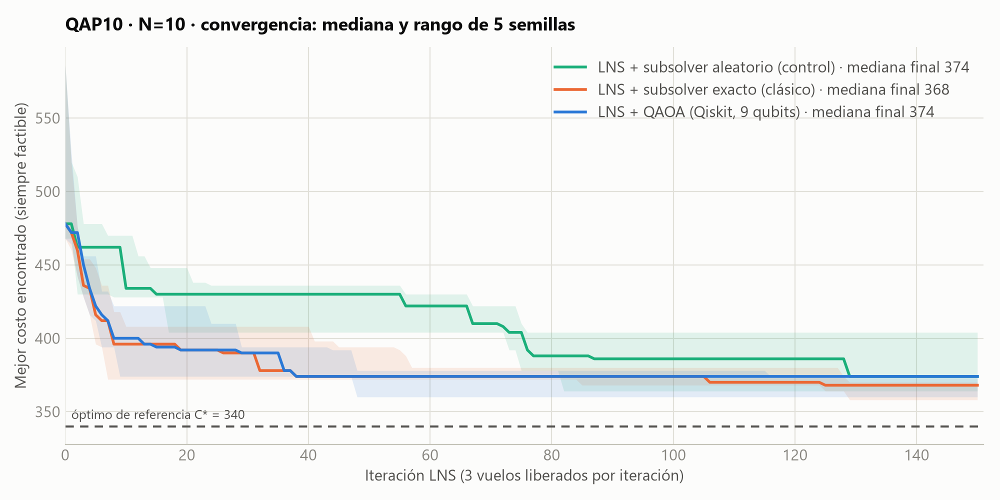
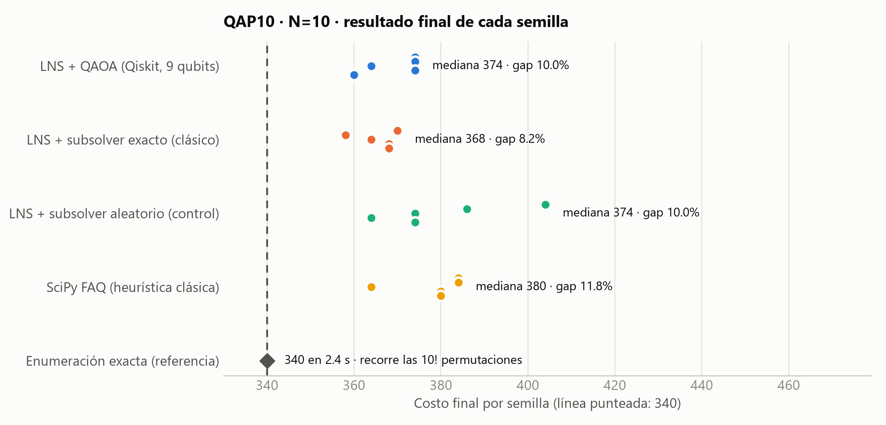
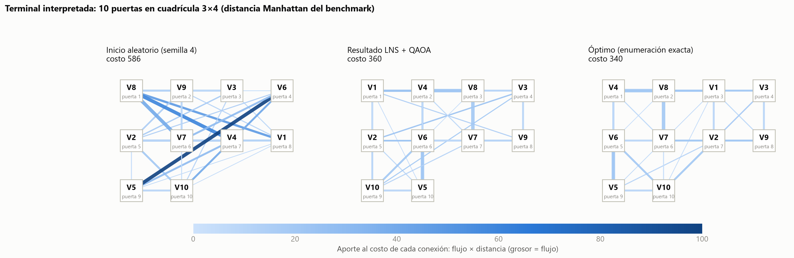

# Híbrido LNS + QAOA · instancia completa N=10

Reproducir: `python hybrid_experiment.py` (≈8 min) y luego `python tools/plot_hybrid.py`.
Datos: `results/hybrid_n10.json` (todas las corridas con su historial) y `results/hybrid_n10_summary.csv`.
Configuración: K=3, 150 iteraciones, 5 semillas, QAOA con mezclador de intercambio, p=2, COBYLA ≤60 evaluaciones, 512 shots, Aer sin ruido.

## Por qué un híbrido

El QUBO completo de N=10 tiene 100 variables binarias, y simular su statevector exige 2^100 amplitudes, lo cual es imposible. Además, el mezclador de intercambio ya pesa 1920 compuertas de 2 qubits en 16 qubits. Por eso Qiskit no ataca el problema entero. Resuelve **subproblemas de 9 qubits** dentro de una búsqueda clásica por vecindarios.

## Cómo funciona

1. **Inicio:** una asignación aleatoria válida, con semilla.
2. **Vecindario:** en cada iteración se liberan K=3 vuelos. La mitad de las veces se eligen al azar; la otra mitad se elige un vuelo y se muestrean dos socios con probabilidades que favorecen los flujos mayores. No es una elección determinista de los dos mayores.
3. **Subproblema:** los 3 vuelos se reparten las 3 puertas que ya ocupaban. Es un QAP de 3×3 con un **término lineal**: el costo de cada vuelo libre frente a los 7 vuelos fijos. Se cumple que costo total = constante + costo del subproblema, y eso se verifica en cada iteración y en los tests.
4. **Subsolver Qiskit:** QAOA con mezclador de intercambio en 9 qubits. Toda muestra es una permutación válida, así que no hace falta reparación. Se toma la mejor muestra.
5. **Aceptación:** se acepta si el costo no empeora. Tras 12 iteraciones sin mejora, se barajan 4 vuelos al azar (patada ILS) para salir del óptimo local. Se guarda la mejor asignación vista.

**Controles con los mismos vecindarios y la misma semilla:**
- un subsolver **exacto** que prueba las 3! permutaciones;
- un subsolver **aleatorio**, que elige una permutación cualquiera;
- además, la heurística **SciPy FAQ** y la **enumeración exacta** como referencia.

## Resultados (5 semillas)

| Método | Mejor | Mediana | Gap mediano | Llega a 340 | Factible | Tiempo mediano |
|---|---|---|---|---|---|---|
| LNS + QAOA (9 qubits) | 360 | 374 | 10.0 % | 0/5 | 5/5 | 83 s |
| LNS + subsolver exacto | 358 | 368 | 8.2 % | 0/5 | 5/5 | 0.02 s |
| LNS + subsolver aleatorio | 364 | 374 | 10.0 % | 0/5 | 5/5 | 0.02 s |
| SciPy FAQ | 364 | 380 | 11.8 % | 0/5 | 5/5 | 0.002 s |
| Enumeración exacta (10!) | 340 | — | 0 % | — | sí | 2.4 s |

El gap se calcula como 100 · (C − 340) / 340, solo sobre asignaciones válidas. Todas lo son. Nada se reparó. El tiempo de la enumeración exacta varía entre corridas (2.4 s aquí, 2.6 s en el estudio de escalamiento): son mediciones de corridas distintas, no un cambio del método.

**Calidad del subsolver cuántico:** en 750 llamadas a QAOA, la mejor muestra fue el óptimo del subproblema en el **89 %** de los casos (mediana por semilla). La probabilidad media de muestrear el óptimo por llamada fue de **48 %**. El azar acierta al menos 1 de 6 (17 %), y más si el subproblema tiene empates.

En el mapa se ve el efecto de la optimización. Con el inicio aleatorio, las conexiones de mayor flujo cruzan la terminal (líneas gruesas y oscuras). Tras el LNS, esos pares quedan en puertas vecinas.

## Lectura honesta

- **El híbrido funciona de punta a punta:** produce asignaciones válidas para N=10, con un gap del 6–10 % (mejor caso: 360), y usa Qiskit de forma sustantiva en cada iteración.
- **No supera al clásico en estas corridas.** Con K=3, el LNS con subsolver exacto obtiene menor mediana (368 contra 374), y QAOA empata en mediana con el subsolver aleatorio. Cinco semillas permiten una comparación exploratoria; no se realizó una prueba que establezca significancia ni equivalencia estadística.
- **Hipótesis sobre el límite observado:** con vecindarios de 3 vuelos, el bucle externo puede limitar la calidad global: cada subproblema solo tiene 3! = 6 opciones y aun así el método no llegó a 340. La tasa alta de acierto local de QAOA no demuestra por sí sola que el bucle externo sea la causa; también influyen K, inicialización, patadas, regla de aceptación y variación entre semillas. En la primera corrida, sin patadas, todas las variantes se estancaban en 364–392. Con las patadas ILS, el subsolver exacto empezó a separarse del aleatorio.
- **Ningún método de búsqueda local llegó a 340** en 150 iteraciones. La enumeración exacta sí, en 2.4 s. Para N=10, la respuesta correcta en producción es clásica.

## Escalabilidad (pregunta del Día 2, N ≥ 14)

**Actualización para la final:** la prueba medida N=10…14 ya está en [`scaling14_results.md`](scaling14_results.md), con referencia exacta, cinco semillas, calidad, factibilidad y memoria/tiempo por método. La tabla siguiente conserva la proyección del Día 1 y sus supuestos; no describe la campaña nueva. El nuevo baseline de ramificación y poda evita la enumeración factorial completa.

| | N=10 | N=14 |
|---|---|---|
| Permutaciones | 3.6 × 10^6 | 8.7 × 10^10 |
| Enumeración exacta (proyección ingenua a velocidad constante) | 2.4 s | ≈ 16 h (24 024 veces más; no medido) |
| Statevector del QUBO completo | 2^100 amplitudes | 2^196 amplitudes |
| Una iteración del LNS + QAOA | 9 qubits, ~0.55 s de mediana observada | No medido para N=14; 9 qubits si se mantiene K=3, pero el tiempo total puede cambiar |

Con K fijo, el subcircuito conserva K² qubits al crecer N; eso no garantiza tiempo total constante. La proyección de 16 horas solo extrapola el conteo de permutaciones a partir de N=10 y supone velocidad constante. La implementación exacta actual usa bloques vectorizados que también crecen en memoria, así que el tiempo y la memoria de N=14 deben medirse con una instancia definida y un baseline que pueda procesarla.

Siguientes pasos:
- vecindarios más grandes (K=4, 16 qubits; ~6 s por llamada en simulación);
- usar la distribución de QAOA para elegir vecindarios, no solo para resolverlos;
- medir el efecto del ruido con un modelo de backend;
- comparar con un tabu search clásico en N=14.
