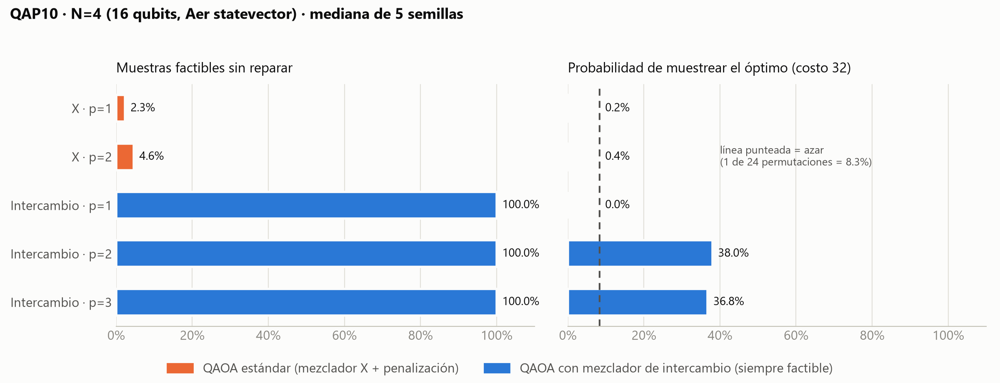

# Resultados QAOA · N=3 y N=4

Reproducir: `python qaoa_sweep.py` (≈20 min) y luego `python tools/plot_qaoa.py`.
Datos crudos: `results/qaoa_sweep.csv` (140 corridas). Resumen: `results/qaoa_sweep_summary.json`.
Simulación ideal (Aer statevector, sin ruido), COBYLA hasta 100 evaluaciones, 2048 shots, semillas 0–4.

## Qué cambió respecto al primer intento

| Problema del primer intento | Corrección |
|---|---|
| Coeficientes del Hamiltoniano de hasta 273 con γ ∈ [0, π]: fases caóticas | Se normaliza H antes de construir el circuito |
| λ = 120 sin justificar | λ = max_i Σ_k F_ik · max D + 1 (cota suficiente). Se verifica que el estado base del QUBO es una permutación |
| 0 % de muestras factibles; el 32 lo producía la reparación húngara | Mezclador de intercambio que nunca sale del espacio de permutaciones |
| No había comparación contra el azar | Métrica P(óptimo) vs. el número de asignaciones óptimas dividido entre N! para una permutación válida aleatoria |

## Dos ansatz

- **X (estándar):** Hadamard inicial, mezclador RX, restricciones solo por penalización. Explora los 2^(N²) estados.
- **Intercambio (perm):** parte de una permutación aleatoria con semilla. Cada término del mezclador intercambia las puertas de dos vuelos (`x_ij x_kl ↔ x_il x_kj`) y se implementa con `PauliEvolutionGate`. Sus 8 cadenas de Pauli conmutan, así que la evolución es exacta y el estado se queda en las N! permutaciones. Esto se comprueba en los tests.
- **XY por filas (descartado):** conserva un vuelo por fila, pero las penalizaciones de columna lo dejan pegado en el estado inicial.

## Resultados N=4 (16 qubits, óptimo 32, dos asignaciones óptimas de 24, mediana de 5 semillas, α = 1)

| Ansatz | p | Factibles sin reparar | P(óptimo) | vs. azar (8.3 %) | Tiempo de entrenamiento |
|---|---|---|---|---|---|
| X | 1 | 2.3 % | 0.2 % | 0.02× | 0.5 s |
| X | 2 | 4.6 % | 0.4 % | 0.05× | 2.0 s |
| X | 3 | 3.7 % | 0.3 % (por semilla: 1.3, 0.2, 0.6, 0.3, 0.3 %) | 0.04× | 2.6 s |
| Intercambio | 1 | 100 % | 0.0 % (mejor semilla: 100 %) | 0.00× | 1.5 s |
| Intercambio | 2 | 100 % | 38.0 % (por semilla: 0, 38, 0, 38, 100 %) | 4.6× | 6.3 s |
| Intercambio | 3 | 100 % | **36.8 %** (por semilla: 10, 37, 31, 37, 100 %) | **4.4×** | 14.0 s |

La fila X con p=3 se agregó (5 semillas, mismos parámetros, corridas registradas en `results/visual_demo.json`) para comparar mezcladores a igual profundidad: tampoco supera al azar. En N=3, X con p=3 da una mediana de 10.0 % de P(óptimo) contra 33.3 % del azar.

**Ojo con p=2:** su mediana de 38 % depende de qué semillas se tomen. Con las semillas 0–2, la mediana es 0 % (lo confirmó el estudio de escalamiento, `scaling_study.py`). **p=3 es la configuración robusta:** las 5 semillas superan al azar (la peor por poco: 10 % contra 8.3 %) y la media es 43 %. Es la que usamos como resultado principal.

En N=3, 2 de las 6 permutaciones son óptimas, así que en 3 de las 5 semillas el arranque ya era óptimo. Esas corridas se excluyen del resumen. En las 2 restantes, el intercambio con p=3 alcanza P(óptimo) = 43.6 % frente al 33.3 % del azar (1.3×).

## Otros hallazgos

- **λ (solo afecta al mezclador X):** con 0.5×, 1×, 2× y 4× la cota, la factibilidad queda en 3–17 % y nunca supera al azar. El estado base es factible incluso con 0.5×: la cota es suficiente, no necesaria. Subir λ no arregla QAOA estándar; el cuello de botella es el ansatz.
- **CVaR (α = 0.25):** mejora un poco el mezclador X (N=3, p=2: de 4.5 % a 5.7 %), pero baja la mediana del intercambio (N=4, p=2: de 38 % a 26 %). Nos quedamos con α = 1.
- **Varianza entre semillas:** con p=1 y p=2, el intercambio va de 0 % a 100 % según la semilla, porque COBYLA cae en mínimos locales. Con p=3, todas las semillas encuentran algo.

## Costo en hardware (transpilado a GenericBackendV2: cx, rz, sx, x; p=1)

| N | Ansatz | Qubits | Profundidad | Compuertas de 2 qubits |
|---|---|---|---|---|
| 3 | X | 9 | 53 | 72 |
| 3 | Intercambio | 9 | 741 | 504 |
| 4 | X | 16 | 74 | 192 |
| 4 | Intercambio | 16 | 1677 | 1920 |

El intercambio garantiza factibilidad en el circuito estudiado, pero a p=1 cuesta unas 10 veces más compuertas de 2 qubits tras esta transpilación. Ese conteo plantea una preocupación sobre sensibilidad al ruido; no medimos un backend físico ni un modelo de ruido, así que no afirmamos que el circuito necesariamente perdería la coherencia.

## Conclusión honesta

- El QAOA estándar con penalizaciones **no supera al muestreo aleatorio** en ninguna configuración probada de λ, p o CVaR.
- Codificar la restricción en el mezclador sí funciona en simulación ideal: **100 % de factibilidad y una mediana de 37 % de P(óptimo), 4.4× el azar,** en N=4 con p=3, con las 5 semillas por encima de 0 %.
- No hay ventaja frente al clásico: la enumeración exacta resuelve N=4 en microsegundos. El valor está en medir **qué parte del diseño cuántico importa**: el mezclador, no λ.
- Escalar: el statevector deja de ser viable sobre 16–20 qubits. Para N=10 se usa este solver como subrutina sobre vecindarios de K=3–4 vuelos (rama `hybrid-lns`).
