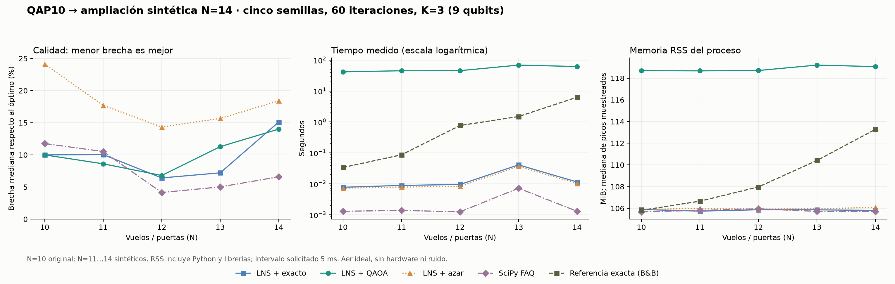

# Escalamiento final: QAP10 → N=14

**N=14: óptimo certificado 728; LNS + QAOA: mejor 794, mediana 830, brecha mediana 14.01%, 0/5 semillas alcanzaron el óptimo.**



## Instancias y procedencia

N≤10 mantiene las primeras N filas y columnas de QAP10. La ampliación N=11…14 es sintética y anidada: conserva exactamente las matrices originales de diez elementos. Para cada nuevo vuelo k y cada i<k se muestrea un flujo de los 45 valores originales F[i,k] (incluidos los ceros), en orden k=10…13, i=0…k−1, con NumPy default_rng y semilla **20261025**. La matriz F sigue siendo simétrica, entera y de diagonal cero. Las puertas continúan la cuadrícula de cuatro columnas: D[a,b]=2·(|a//4−b//4|+|a%4−b%4|). Cada N usa el bloque principal de la misma ampliación.

Es un escenario de escalamiento del equipo; **no es un benchmark MIPLIB QAP14 ni una ampliación medida en un aeropuerto real**. Los datos se fijan con independencia de las semillas de optimización y del resultado. Cada par i<k cuenta una vez.

## Referencias óptimas certificadas

| N | Óptimo | Cota final | Nº óptimos | Tiempo medido (s) | RSS pico (MiB) | Nodos B&B |
|---|---:|---:|---:|---:|---:|---:|
| 10 | 340 | 340 | 1 | 0.0339 | 105.8 | 1,100 |
| 11 | 418 | 418 | 1 | 0.0871 | 106.7 | 4,476 |
| 12 | 530 | 530 | 4 | 0.7699 | 108.0 | 52,482 |
| 13 | 638 | 638 | 1 | 1.4971 | 110.4 | 101,041 |
| 14 | 728 | 728 | 1 | 6.3164 | 113.3 | 188,543 |

La referencia usa **ramificación y poda (branch and bound), cota Gilmore–Lawler y asignación lineal de SciPy**. Comienza con soluciones obtenidas por FAQ + 2-opt desde ocho semillas clásicas; nunca carga el óptimo conocido. La búsqueda exacta certifica el mínimo y cuenta todas las asignaciones que lo alcanzan. Las primeras 32 se guardan como ejemplos.

En un nodo, C es el costo ya fijado y M[i,j] es la interacción de un vuelo libre con los vuelos fijos. Para cada fila, ordenamos los flujos restantes de menor a mayor y las distancias de mayor a menor, excluyendo las diagonales. Su producto es una cota inferior por reordenamiento que relaja la consistencia entre vuelos. La asignación lineal de la matriz 2M+A_ordenada·B_ordenadaᵀ da una cota para **dos veces** el costo restante. Se poda solo si 2C+cota>2·mejor; la desigualdad estricta permite contar también óptimos empatados. Todos estos cálculos usan enteros. Al agotar el árbol, el mejor costo es óptimo global. Si vence el tiempo límite, el script no declara un óptimo y detiene la generación del informe.

El nuevo exacto reproduce los controles N=3→24, N=4→32 y N=10→340. Además, se ejecutó la enumeración de N=10 en la misma campaña: costo 340, 3.6528 s, RSS pico 362.9 MiB. Las pruebas comparan el nuevo exacto y el número de óptimos contra enumeración independiente de seis instancias pequeñas aleatorias, con términos lineales; no sustituyen una certificación independiente de N=14 por otro solver.

## Comparación de métodos

| N | Método | Mediana | Mejor | Brecha mediana | Aciertos óptimos | Tiempo mediano (s) | RSS mediana (MiB) |
|---|---|---:|---:|---:|---:|---:|---:|
| 10 | LNS + exacto | 374 | 372 | 10.00% | 0/5 | 0.0078 | 105.9 |
| 10 | LNS + azar | 422 | 404 | 24.12% | 0/5 | 0.0073 | 105.9 |
| 10 | SciPy FAQ | 380 | 364 | 11.76% | 0/5 | 0.0013 | 105.7 |
| 10 | LNS + QAOA | 374 | 360 | 10.00% | 0/5 | 41.7085 | 118.7 |
| 11 | LNS + exacto | 460 | 426 | 10.05% | 0/5 | 0.0089 | 105.7 |
| 11 | LNS + azar | 492 | 480 | 17.70% | 0/5 | 0.0079 | 106.0 |
| 11 | SciPy FAQ | 462 | 426 | 10.53% | 0/5 | 0.0014 | 105.8 |
| 11 | LNS + QAOA | 454 | 426 | 8.61% | 0/5 | 45.1587 | 118.7 |
| 12 | LNS + exacto | 564 | 548 | 6.42% | 0/5 | 0.0096 | 105.9 |
| 12 | LNS + azar | 606 | 566 | 14.34% | 0/5 | 0.0084 | 105.9 |
| 12 | SciPy FAQ | 552 | 540 | 4.15% | 0/5 | 0.0013 | 106.0 |
| 12 | LNS + QAOA | 566 | 540 | 6.79% | 0/5 | 45.4928 | 118.7 |
| 13 | LNS + exacto | 684 | 672 | 7.21% | 0/5 | 0.0411 | 105.9 |
| 13 | LNS + azar | 738 | 688 | 15.67% | 0/5 | 0.0369 | 106.0 |
| 13 | SciPy FAQ | 670 | 660 | 5.02% | 0/5 | 0.0072 | 105.7 |
| 13 | LNS + QAOA | 710 | 688 | 11.29% | 0/5 | 68.8608 | 119.2 |
| 14 | LNS + exacto | 838 | 816 | 15.11% | 0/5 | 0.0115 | 105.8 |
| 14 | LNS + azar | 862 | 858 | 18.41% | 0/5 | 0.0103 | 106.1 |
| 14 | SciPy FAQ | 776 | 764 | 6.59% | 0/5 | 0.0013 | 105.7 |
| 14 | LNS + QAOA | 830 | 794 | 14.01% | 0/5 | 61.8352 | 119.1 |

Todos los resultados de la tabla son asignaciones factibles. El gap utiliza el óptimo certificado de **cada instancia**, no 340 para todos los tamaños. Las corridas empiezan sin conocer el óptimo. El híbrido usa resultados crudos factibles del mezclador de intercambio; no requiere reparación clásica.

En N=14, la mediana de acierto del óptimo **local** por llamada fue 90.0%. El óptimo **global** se alcanzó en 0/5 semillas. Resolver un vecindario de seis opciones no garantiza la mejor permutación completa. La calidad depende también de los vecindarios, las patadas, los arranques y las propuestas del subsolver; estas corridas no aíslan una única causa del estancamiento.

La comparación de N=14 distingue los controles: mediana QAOA 830, LNS con exacto local 838 y FAQ 776. Sus tiempos medianos fueron 61.8352, 0.0115 y 0.0013 s. Un mejor recorrido dentro de una trayectoria LNS no demuestra que el subsolver sea más exacto: los estados aceptados, el estancamiento y las patadas divergen. Se necesita distinguir mejor costo, mayor probabilidad y menor tiempo, y comprobar resultados con más familias de instancias antes de generalizar.

## Protocolo y límites de las mediciones

- Cinco semillas 0…4 por método y tamaño; 60 iteraciones LNS, K=3, patada de 4 vuelos tras 12 iteraciones sin mejora.
- QAOA: p=2, COBYLA con hasta 60 evaluaciones, 512 shots; Qiskit Aer statevector ideal. Cada llamada usa nueve qubits; el QUBO completo de N=14 tendría 196 qubits y no se simula.
- Aceleración de simulación: el entrenamiento reproduce exactamente el mismo circuito en el subespacio de las seis permutaciones factibles, mediante fases y rotaciones de intercambio. Es cálculo clásico de amplitudes; no es hardware. Después se verifica la distribución entrenada con el circuito completo de nueve qubits en Aer y se obtienen los 512 shots con SamplerV2 de Qiskit. La verificación es obligatoria en **cada llamada** y aborta si el error máximo supera 1e−8. En esta campaña se verificaron 1500 llamadas, con error máximo de probabilidad 6.517e-09. Los tests también comparan ambas simulaciones en ángulos arbitrarios N=3/4. El redondeo numérico puede cambiar la trayectoria de COBYLA frente a corridas históricas, aunque ambas formas representan el mismo circuito; por eso N=10 se midió otra vez.
- LNS exacto, aleatorio y QAOA comparten por semilla la asignación inicial y los vuelos liberados en cada iteración. Las propuestas y las aceptaciones pueden producir estados distintos. La referencia global no interviene en esa búsqueda.
- Las corridas se miden en procesos separados y de forma secuencial. Cada proceso importa la misma pila de librerías antes de medir. OpenMP, OpenBLAS, MKL y Rayon se limitan a un hilo; se desactiva el paralelismo de Qiskit. Esto evita sobrecostos de concurrencia en estos circuitos pequeños; no modifica el circuito ni el presupuesto de búsqueda.
- El tiempo incluye la llamada completa al solver, sus inicios heurísticos y la validación de las trazas; excluye imports, arranque del proceso y escritura del JSON. La reproducción visual usa las marcas internas de cada iteración.
- Memoria: RSS del proceso con intervalo solicitado de 5 ms durante el solver, incluyendo Python y librerías. Se guardan RSS inicial, pico observado, incremento y pico de vida del proceso, además de tiempo CPU. El muestreo puede omitir picos breves. Los métodos muy rápidos pueden tener pocas muestras; un incremento cero no significa uso de memoria cero. No es memoria de una QPU.
- Se comparan presupuestos de iteraciones, **no presupuestos iguales de tiempo**. FAQ usa su propio criterio de parada. Los tiempos históricos sin estos controles se conservan y no se mezclan con los nuevos para calcular aceleraciones.
- Los tiempos corresponden a esta máquina y campaña. La carga y la frecuencia de CPU pueden cambiar durante el barrido; no se estima una ley asintótica ni el tiempo de ejecución de una QPU.
- Cinco semillas y una familia sintética no permiten generalizar a otros aeropuertos o instancias, ni demostrar ventaja cuántica.

## Qué cambia al presentar la demo

El selector cubre N=1…14, con accesos N=4, N=10 y N=14. Para N=10…14 están disponibles las cinco semillas y sus trazas verdaderas. N>10 muestra la etiqueta ampliación sintética. «Óptimo exacto» carga la asignación global certificada; «Óptimo → resultado QAOA» permite ver las conexiones responsables de la brecha. Los tiempos de cálculo son mediciones; el desplazamiento de las personas usa segundos ilustrativos y distancia del modelo. Una llegada más temprana de un grupo no reemplaza la comparación del costo total.

La comparación nueva de N=10 usa 60 iteraciones, para emparejarla con N=11…14. El estudio histórico de N=10 con 150 iteraciones sigue en su apartado propio. El QAOA directo N=3/4 conserva sus experimentos originales.

## Reproducción y archivos

```powershell
pip install -r requirements.txt
python scaling14_study.py
python tools/report_scaling14.py
python -m pytest tests
streamlit run app/app.py
```

La ejecución reanuda únicamente jobs con parámetros y hash del código compatibles. `python scaling14_study.py --assemble-only` reconstruye las tablas de los jobs completos sin volver a calcular.

- `results/scaling14.json`: matrices, referencias, configuración, resumen y trazas LNS.
- `results/scaling14_summary.csv`: tabla de métricas por método/tamaño.
- `results/scaling14_jobs/`: cada medición individual, semillas, asignaciones, trazas, memoria, entorno y hash del código.
- `src/qap/exact_bound.py`: método exacto y derivación de su cota.

Fuentes del método: [Lawler, 1963](https://doi.org/10.1287/mnsc.9.4.586), [asignación lineal SciPy](https://docs.scipy.org/doc/scipy/reference/generated/scipy.optimize.linear_sum_assignment.html), [FAQ y 2-opt SciPy](https://docs.scipy.org/doc/scipy/reference/generated/scipy.optimize.quadratic_assignment.html).

Hash de las fuentes ejecutadas: `6dea059ae5020af2ed357ccad230a4630882118bf319af9fd92e825003a546be`.

Entorno medido:

```json
{
  "python": "3.13.7",
  "os": "Windows-11-10.0.26300-SP0",
  "thread_environment": {
    "OMP_NUM_THREADS": "1",
    "OPENBLAS_NUM_THREADS": "1",
    "MKL_NUM_THREADS": "1",
    "RAYON_NUM_THREADS": "1",
    "QISKIT_PARALLEL": "FALSE"
  },
  "processor": "Intel64 Family 6 Model 183 Stepping 1, GenuineIntel",
  "logical_cpus": 32,
  "ram_bytes": 16779833344,
  "versions": {
    "qiskit": "2.6.1",
    "qiskit-aer": "0.18.0",
    "numpy": "2.5.4",
    "scipy": "1.18.1",
    "psutil": "7.2.2"
  }
}
```
