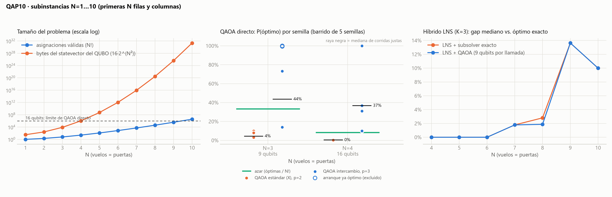

# Corroboración y escalamiento · N=1…10

**Extensión final disponible:** [`scaling14_results.md`](scaling14_results.md) documenta N=10…14, con cinco semillas por tamaño, referencia exacta por ramificación y poda y memoria/tiempo medidos. N>10 es una ampliación sintética que preserva QAP10. Este documento conserva la campaña histórica de tres semillas; sus tiempos no se combinan con los de la campaña nueva.

Reproducir: `python scaling_study.py` (≈12 min) y luego `python tools/plot_scaling.py`.
Datos: `results/scaling.csv` y `results/scaling.json`. Cada N usa las primeras N filas y columnas de QAP10, como pide el reto para los controles.

## Tabla completa

| N | Óptimo exacto | Control del reto | Asignaciones óptimas / N! | Costo medio al azar | Tiempo exacto | Qubits del QUBO | LNS + QAOA (mediana) | LNS + exacto (mediana) |
|---|---|---|---|---|---|---|---|---|
| 1 | 0 | — | 1 / 1 | 0 | <1 ms | 1 | — | — |
| 2 | 10 | — | 2 / 2 | 10 | <1 ms | 4 | — | — |
| 3 | **24** | 24 ✅ | 2 / 6 | 26.7 | <1 ms | 9 | — | — |
| 4 | **32** | 32 ✅ | 2 / 24 | 46.7 | <1 ms | 16 | 32 (3/3 óptimo) | 32 (3/3) |
| 5 | 58 | — | 2 / 120 | 88.0 | <1 ms | 25 | 58 (3/3) | 58 (3/3) |
| 6 | 94 | — | 2 / 720 | 139.2 | 2 ms | 36 | 94 (2/3) | 94 (3/3) |
| 7 | 112 | — | 2 / 5 040 | 171.4 | 4 ms | 49 | 114 (gap 1.8 %) | 114 (1.8 %) |
| 8 | 214 | — | 4 / 40 320 | 308.0 | 91 ms | 64 | 218 (1.9 %) | 220 (2.8 %) |
| 9 | 264 | — | 1 / 362 880 | 417.8 | 0.23 s | 81 | 300 (13.6 %) | 300 (13.6 %) |
| 10 | **340** | 340 ✅ | 1 / 3 628 800 | 511.7 | 2.6 s | 100 | 374 (10.0 %) | 374 (10.0 %) |

Configuración del LNS: K=3, 60 iteraciones, 3 semillas. Entre paréntesis van las semillas que llegaron al óptimo, o el gap mediano.

## Qué corrobora

- **Los tres controles del reto (24, 32 y 340) salen exactos,** a partir de las matrices que recuperamos del MPS. Además, los óptimos de N=5–9 se calculan por enumeración completa.
- **N=1 y N=2 son triviales:** con N=1 hay una sola asignación, y con N=2 las dos cuestan lo mismo, porque D es simétrica. Por eso el reto empieza en N=3. El script de escalamiento sí ejecuta QAOA en N=2 como control; no demuestra capacidad de optimización porque todas las asignaciones válidas son óptimas. No ejecuta QAOA en N=1.
- **Las asignaciones óptimas suelen venir en pares para N=2–7** (4 en N=8, una sola en N=9 y N=10). Es probable que se deba a simetrías de la cuadrícula de puertas, pero no lo verificamos. Para comparar de forma justa importa porque duplica la probabilidad de acertar al azar, y por eso el baseline usa "asignaciones óptimas / N!" y no 1/N!.

## Dónde se rompe cada método

| Método | Funciona hasta | Por qué se detiene |
|---|---|---|
| QAOA directo (statevector) | N=4 (16 qubits) | Con N=5 el QUBO necesita 25 qubits: 512 MiB solo de statevector, y crece ×2^(2N+1) por paso |
| Híbrido LNS + QAOA (K=3) | Óptimo hasta N=6, gap ≤ 2 % hasta N=8 | Cada subproblema sigue en 9 qubits, pero vecindarios de 3 vuelos no bastan para salir de los óptimos locales de N=9–10 |
| Enumeración exacta | N=10 en 2.6 s | Crece como N!: ×10 de N=9 a N=10. N=14 sería unas 24 000 veces N=10 (proyección no medida) |

**Varianza de QAOA en N=4:** con p=2 hay semillas que aciertan el 100 % y otras el 0 %. Con 3 semillas la mediana da 0 %, y con 5 da 38 %. El panel del medio muestra cada semilla y usa p=3, que es más estable. Ver [`qaoa_results.md`](qaoa_results.md).
